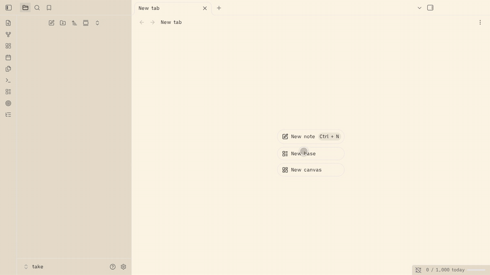
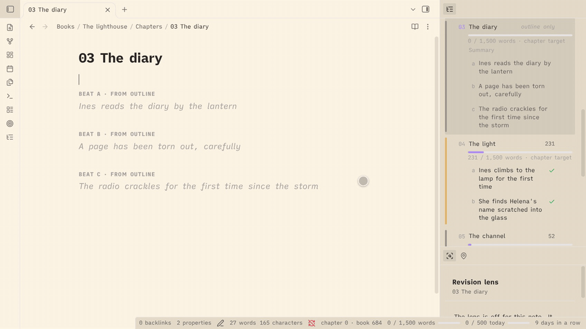
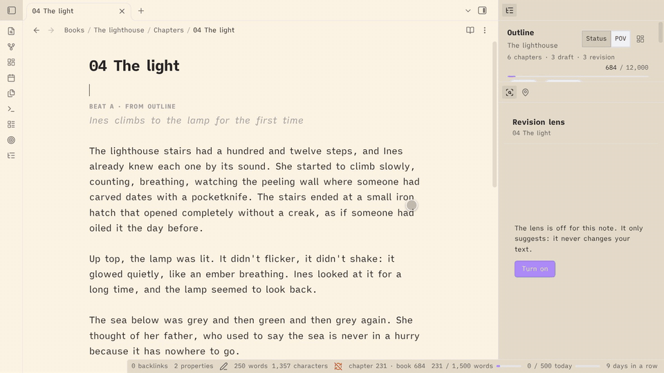
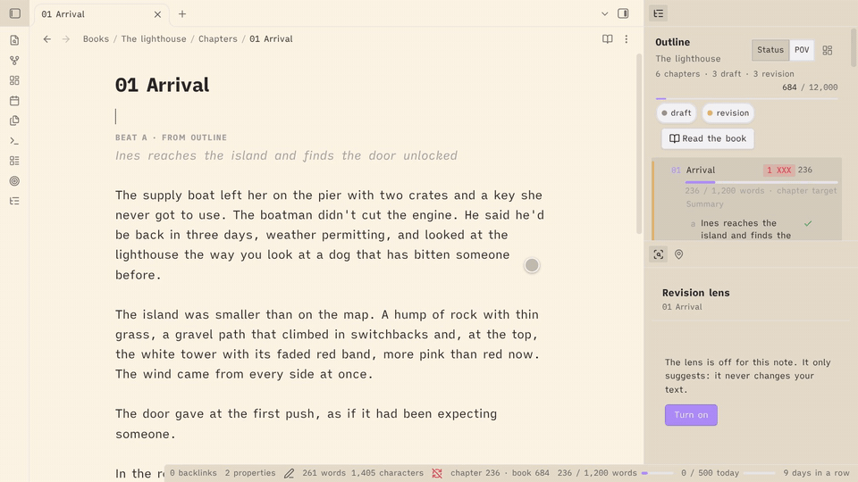
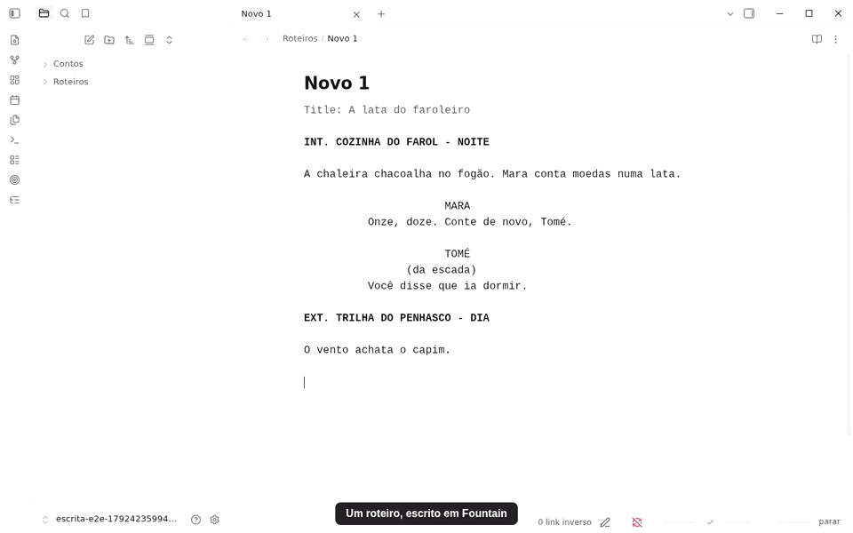

<p align="center">
  <picture>
    <source media="(prefers-color-scheme: dark)" srcset="docs/images/banner-dark.png">
    
  </picture>
</p>

<p align="center">
  <a href="https://github.com/ClaudioDavi/escrita/releases/latest"></a>
  
  
  
  <a href="LICENSE"></a>
</p>

<p align="center">
  <a href="#install">Install</a> ·
  <a href="docs/guide/en/getting-started.md">Getting started</a> ·
  <a href="docs/guide/pt-BR/getting-started.md">Comece aqui (português)</a> ·
  <a href="#what-escrita-does">Features</a> ·
  <a href="#changelog">Changelog</a>
</p>

An Obsidian plugin for fiction writers: an outline that lives inside your chapters, word goals and sprints, placeholders, a safe place for the passages you cut, a revision lens, manuscript export, and a shared universe of characters and places.

Your books stay plain Markdown. Everything Escrita adds to a chapter is an Obsidian comment (`%% … %%`), so it is hidden in Reading view and by most publishing tools. Escrita never contacts a server or a model, and it never changes your prose unless you click.

Escrita is inspired by [NEO](https://github.com/hughhowey/neo) by Hugh Howey (MIT License). Parts of its design and logic are adapted from NEO. Escrita is not affiliated with NEO or its author.

## Install

It needs Obsidian **1.13 or later**. It works on desktop and on phones.

- **[Community plugins](https://obsidian.md/plugins?id=escrita)**: open Settings → Community plugins → Browse, search for "Escrita", then install and enable it.
- **With BRAT**: install the [BRAT](https://github.com/TfTHacker/obsidian42-brat) plugin, choose "Add a beta plugin", and enter `ClaudioDavi/escrita`.
- **Manually**: download `main.js`, `manifest.json` and `styles.css` from the latest [release](https://github.com/ClaudioDavi/escrita/releases), put them in `<your vault>/.obsidian/plugins/escrita/`, reload Obsidian, and enable Escrita in Settings → Community plugins.

## Getting started

1. Enable Escrita. A notice offers to set the vault up; you can also run **Set up a writing vault** from the command palette.
2. The setup shows everything before it creates anything. Pick a starting point (Essentials, Writer or Everything), a layout, and the folders and examples you want.
3. Open the example short story or book, or run **New work…** (a short story or a book, from a title), and write. Escrita sets no hotkeys; bind the commands you use in Settings → Hotkeys.

Step by step: [Getting started](docs/guide/en/getting-started.md) ([Português](docs/guide/pt-BR/getting-started.md)).



## What Escrita does

Each part is a switch on the Features page, so you can turn off what you don't use. Every command and setting is described in the guide for its group. The guides are in English and in Brazilian Portuguese.

**Features and settings.** The Features page turns each part on or off. It has three starting points (Essentials, Writer, Everything), and a fresh install takes its defaults (status words, folder names) from Obsidian's language. A feature that is off isn't loaded, and its data stays. Guide: [English](docs/guide/en/features-and-settings.md) · [Português](docs/guide/pt-BR/features-and-settings.md).

**Writing.** **New work…**, **New short story**, **New screenplay** and **New book** start a note that is already a work in the draft stage, from a built-in template or a note of yours, with the cursor in the prose; the home note has the same two buttons. The outline sits in the sidebar and lists your chapters and their beats, with point of view, filters, a board and a "Read the book" view; "Read this note" reads a short story, an essay or a collection the same way. Goals, pacing, sprints, days off, targets for a single short story or essay, placeholders, Enter flow, smart typography, dialogue focus, moving a paragraph or scene, templates, spellcheck on demand and word counts in the file explorer are here too. A note whose form is `screenplay` is laid out as on the page in Live Preview, with Tab and Enter as in a screenwriting program, capitals as you type, and suggestions for cues, places and times of day (the screenplay editor, in [Screenplays](docs/guide/en/screenplays.md#write-in-the-editor)). Guide: [English](docs/guide/en/writing.md) · [Português](docs/guide/pt-BR/writing.md).



**Tracking.** Works move through five stages (idea, draft, revision, ready, published), mapped to your own status words. The home note shows what to write today and opens each work where you left off. Writing mode strips the screen down to the note. A snapshot is taken at each stage change. Guide: [English](docs/guide/en/tracking.md) · [Português](docs/guide/pt-BR/tracking.md).

**Revision.** The revision lens underlines what is worth rereading (echoes, adverbs, gerunds, crutch words, name variants, long sentences) and never changes your text. Its Rhythm section draws one bar per sentence of a paragraph, so a run of sentences of the same length shows. Snapshots keep named and automatic copies of a note that you can compare word by word and restore. Darlings keep the passages you cut, restorable to where they came from. Guide: [English](docs/guide/en/revision.md) · [Português](docs/guide/pt-BR/revision.md).



**Publishing.** The publish check looks for open comments, placeholders and unwritten beats before you mark a note published. Export writes Markdown, DOCX or EPUB (Shunn and pt-BR templates), for a note, a book or a collection of short stories. A screenplay, a note written in Fountain, exports as a PDF (US Letter or A4) or as a Fountain file. Submissions record where a work was sent and what came back. Guide: [English](docs/guide/en/publishing.md) · [Português](docs/guide/pt-BR/publishing.md). Screenplays: [English](docs/guide/en/screenplays.md) · [Português](docs/guide/pt-BR/screenplays.md).




The same as a video: [screenplay-export.mp4](docs/images/screenplay-export.mp4).

**The world.** A shared universe of characters, places, objects, groups and events, with "Appears in", unlinked mentions, names in the editor and the revision lens, and open threads you plant in one story for a later one. Guide: [English](docs/guide/en/the-world.md) · [Português](docs/guide/pt-BR/the-world.md).

## Privacy

No network access, no AI, no telemetry. Escrita never contacts a server or a model, and a test fails if network code ever appears in its source or in the built plugin. Your writing stays in your vault. Word history, settings and what Escrita remembers about published notes are saved in the plugin's `data.json` inside your vault's `.obsidian/plugins/escrita/` folder.

## Languages

Escrita follows Obsidian's language setting. It ships in:

- English
- Português (Brasil)

To add a language, add a key for it (for example `es` or `fr`) with translated strings to `src/strings.ts` and to each `src/*/strings.ts`. English is the source of truth. Missing strings fall back to English. Pull requests are welcome.

## Development

```
npm install
npm run dev      # bundle styles.css once, then rebuild main.js on every change
npm run build    # type check, bundle styles.css and make a production main.js
npm test         # unit tests
```

To try your build, link or copy the repository folder into a test vault's `.obsidian/plugins/escrita/`.

To release, run `npm version <patch|minor|major> --no-git-tag-version` (it updates `manifest.json` and `versions.json`), commit, then push a tag with the bare version number (for example `git tag 0.1.1 && git push --tags`). The release workflow builds the plugin and drafts a GitHub release with `main.js`, `manifest.json` and `styles.css`; publish the draft when it looks right.

## Changelog

### 1.2.3 (2026-10-24)

A fix for the daily word count, again, and one history for every device that syncs the vault.

- **Fix**: words written in a note that stays open count again. 1.2.2 counted none of them in a note kept under a `%%` that never closes, a note that starts with a `---` line, or a stray `%%`. Now words written above an open comment count as you go, words that end up after the closing `%%` count once it is typed, and the text inside the comment never counts. The save that opens a comment records only words it added, the save that closes it records the change since the opener (and takes the book or piece total again), and the hidden words never count. Moving the open `%%` up or down (cut and paste) counts nothing.
- **Fix**: a note's count is taken again each time you open it, and a save still being counted when goals was switched off is dropped. Before, a change synced in while the note was in the background, or words typed while goals was off, could count as written on the next save.
- **Fix**: the streak, today's words and the charts add up across every device that syncs the vault. Before, each device saved its own copy of the days in `data.json` and the last one to save wiped the other's words. Now each device writes its own section of `data.json`, and the streak, goal, charts and status bar read the sum of all of them. The file is read again before each save, when it changes on disk, when the window gets focus and every minute, and each device keeps a backup of its own section in the browser storage of the app. Settings changed on one device now reach the others too: each setting keeps the last change made to it, on whichever device. A book or piece renamed on one device keeps its days on the others, even days that arrive later from a device that was closed, and a book renamed on a device still on 1.2.2 isn't charted twice (unless that device also wrote more words that day). Nothing to set up, but your sync has to carry `.obsidian/plugins/escrita/data.json`. See [Writing on more than one device](docs/guide/en/writing.md#writing-on-more-than-one-device).
- Improvement: a slice of candidate 48: the daily progress that writing mode's counter reads is notified only when today's words or the goal change, not on every status bar repaint. Nothing changes in use.
- Upgrade note: days recorded under 1.2.2 for such notes may be too low. They are not corrected. Update every device that syncs the vault. Going back to 1.2.2 shows only the days written before 1.2.3, and its first save drops the per-device sections from `data.json`; each device brings its own section back from its backup when it runs 1.2.3 again.

### 1.2.2 (2026-10-22)

A fix for the daily word count.

- **Fix**: typing a `%%` comment no longer inflates the words written today. While a comment was open (the `%%` typed, its closer not yet), every word below it stopped counting; closing it brought them back, and the goals counted them as written, once for each comment. The count now waits while a comment, a code fence or the properties block is open, and counts what you wrote once it closes.
- Improvement: a slice of dead code and stale comments (candidate 49): the publish checks no longer re-export `unclosedComment`. Nothing changes in use.
- Upgrade note: days already recorded keep their numbers. If a day looks too high, the words came from comments you added that day.

### 1.2.1 (2026-10-21)

A small release: five fixes, one small addition and a new default.

- **Tab writes under a beat**: in the outline, Tab in a beat's field opens the note in its editor with the cursor on the first line of prose under that beat. A beat with no prose yet gets the cursor on the empty line right after it; Escrita adds that empty line only when there is none, and nothing else changes. Shift+Tab still turns an unwritten beat into a chapter. The hints under the outline list the new key. See [Writing](docs/guide/en/writing.md#edit-from-the-keyboard).
- **Smart typography is on for every note by default**: **Where smart typography applies** now starts as **In every note**, so a short story or an essay gets curly quotes and dashes too. It used to start as **Only in book chapters**.
- **Fixes**:
  - In the outline, Enter in a beat's field sent the cursor to the note's text when the note was open in an editor. It now lands in the new, empty beat field, so you can type one beat after another.
  - The darlings notes and the word lists note are never counted as works. A darlings note made in a vault that tracks every folder (as the setup leaves a new vault) used to get the draft status and show in the home block as a work; goals counted its words too. They get no status now, and the goals ignore them.
  - The screenplay layout no longer flickers when the note is saved.
  - In the lens panel, stepping through a rule's matches no longer scrolls the panel back to the top. The arrow you clicked stays where it was, even when the Rhythm section above it changes as the cursor moves.
- Improvement: required classifier settings and one plugin-folder root (candidate 43). Nothing changes in use.
- Upgrade notes:
  - An install that already has the setting keeps what it had. To get smart typography in every note, set **Settings › Escrita › Editor › Where smart typography applies** to **In every note**.
  - A darlings or word lists note that already has a status from before keeps it. Remove the property if you do not want it listed as a work.

### 1.2.0 (2026-10-19)

You can write a screenplay in the editor, laid out as on the page, and read a short story the way a reader will.

- **The screenplay editor**: in a note whose form is `screenplay`, Live Preview shows the script in columns, in Courier, as on the page. The text stays as you typed it, and Source mode stays plain. Tab and Enter work as in Final Draft, Fade In and Highland: Tab on an empty line cycles action, character, transition and scene heading; Tab after a cue opens a parenthetical; Enter goes from a cue to its dialogue, from dialogue to the next cue, and from a transition to a scene heading. Each step is one undo. Cues, scene headings and transitions come out in capitals as you type, and when you leave a line Fountain would not read as you meant, Escrita adds the forced mark (`@`, a period or `>`). The name of the element shows faintly on an empty line after Tab. A suggestion list offers the cues already in the script (and the universe's names), the locations after `INT. `, and the times of day after ` - `. Two commands, **Next screenplay element** and **Previous screenplay element**, stand in for Tab and Shift-Tab on a phone. The prose Enter flow and dialogue focus are off in a screenplay. See [Screenplays](docs/guide/en/screenplays.md#write-in-the-editor).

  

  The same as a video: [screenplay-editor.mp4](docs/images/screenplay-editor.mp4).
- **New screenplay**: a command (**Novo roteiro** in Portuguese), also **Screenplay** in the **New work…** list. It makes a note in the draft stage with the screenplay form and one beat, opened with the cursor on the empty line so Tab starts the script. Two settings in **New works**, **Screenplays folder** and **Screenplay template**. No hotkey. See [Screenplays](docs/guide/en/screenplays.md#start-a-screenplay).
- **Screenwriter preset**: a fourth starting point, **Screenwriter** (**Roteirista**), on the Features page and in the setup (now a 2×2 grid of cards). It turns on 11 features: the screenplay editor, goals, the outline, placeholders, the lens, snapshots and the stage snapshot, darlings, the works block, export and submissions. It leaves off the Enter flow and smart typography, dialogue focus, moving blocks, templates, explorer counts, spellcheck, the publish check and threads. The universe is untouched. See [Features and settings](docs/guide/en/features-and-settings.md#starting-points).
- **Screenplay editor settings**: a **Screenplay editor** switch in the Writing group of the Features page and a section with the **Font** (Courier or the theme's) and the **Times of day**. Features now has 20 switches.
- **Read this note**: a short story, an essay or a collection opens in the reader, as a book does with **Read the book**. A collection reads its stories in order. The outline of a single note has a button for it. Where you stopped is kept. See [Writing](docs/guide/en/writing.md#read-this-note).
- **Rhythm**: the lens panel has a Rhythm section for the paragraph at the cursor or the selected sentences: one bar per sentence, a line at the long-sentence limit, and runs of three or more sentences within three words of each other in orange. A click selects the sentence. The **Show rhythm** setting turns it off. See [Revision](docs/guide/en/revision.md#rhythm).
- **Fixes**:
  - Typing could be lost in a new note that was tracked as soon as it was made: Escrita added the draft status while the editor still held text it had not saved. The text is saved first now.
  - The same could happen when publishing or unpublishing a note, setting a target or a deadline in the progress window, or editing a chapter summary in the outline while the note had unsaved typing. Each of these saves the note first now.
  - **Read the book** opened before Obsidian had read the notes could show a chapter it should have left out, or a title that was not up to date. It now redraws when the notes are ready, and keeps your place.
  - **Read the book** keeps the first lines of a chapter in view when the top bar is over them.
- Upgrade notes:
  - The **Screenplay editor** switch is **off** after the update, unless every other switch is on (as in **Everything**), in which case it is on and the set still reads Everything. Turn it on in Features › Writing.
  - Essentials (9) and Writer (16) are as they were. Everything is now 19, 20 with the universe.
- Improvements: the editor glue and "reveal on touch" are shared in one place, and six editor plugins moved onto it (candidate 38); "Read the book" rebuilds when the metadata cache is ready (candidate 52); the lens keeps each sentence's length once, the first slice of candidate 47.

### 1.1.1 (2026-10-18)

A code release. Nothing new to use; the plugin looks and works the same.

- **Review bot warnings cleared**: the end-to-end test harness moved under `tests/`, so the review bot no longer reads it as plugin code. Underlines (the lens marks, the name underline and the dotted lines in the interface) are drawn as backgrounds, and the export preview's paragraph indent is a spacer. They look the same, except that the line through a closed thread now has the muted text color.
- **One settings table**: each setting is now one row in one table (its default, how a saved value is cleaned, which features read it and, for words, the Portuguese value). The defaults, the two default sets, the list of which features show which setting rows and the loading code all come from it. The core no longer imports the universe or the lens.
- **A broken `data.json` heals better**: valid data loads exactly as before. Four fixes apply only to a hand-edited or damaged file:
  - A blank **Summary**, **Author** or **Publication date** property comes back as `summary`, `author` or `date`, and these three are trimmed like the other property names.
  - An unknown quote style, paragraph style or typography scope comes back as `curly`, `blank` or `books`. Before, an unknown quote style made dialogue focus and the lens fail.
  - A blank chapters folder, darlings note or global darlings note comes back from your language's defaults, and a blank placeholder marker comes back as `XXX`. These four are also trimmed.
  - The export, submissions and templates folders are cleaned like the short stories and books folders: `/ Exports` becomes `Exports`. A template path that starts with `/ ` loses the space too.
- Improvement: one settings table (candidate 53, the schema half of candidate 37).

### 1.1.0 (2026-10-16)

You can write a screenplay in a note and export it as a PDF.

- **Screenplays**: a note whose form is `screenplay` (the form property, or a form by folder) is read as Fountain: scene headings, action, character cues, dialogue, parentheticals, transitions and centered lines. Indents follow the Fountain spec: leading tabs and spaces are ignored on every line except action, so a tab-indented `CUT TO:` is a transition and a tab-indented name above a line is a cue; action keeps its indent. **Export…** writes a PDF (US Letter by default, or A4) or a Fountain file. A preview shows the pages before anything is written. A PDF is set in Courier 12, with a title page, page numbers from page 2 and, when a speech breaks across pages, the `(MORE)` and `(CONT'D)` labels (`(MAIS)` and `(CONT.)` in Portuguese). A speech splits across pages only at the end of a sentence; otherwise it moves whole to the next page. There is no automatic `(CONT'D)` between speeches and no `CONTINUED:` marks. The window offers **Scene numbers in the margins** and **Keep the %% … %% notes as Fountain notes**, and warnings (such as a character Courier can't print) link to their lines. Books and collections stay prose, even if they hold screenplay notes. See [Screenplays](docs/guide/en/screenplays.md).
- **Screenplays settings**: a group in the Export settings with the scene heading prefixes, the transition endings, the page size, scene numbers, the continues and continued labels, the credit line, the source property and the draft date property.
- **The form outside the universe**: the form property, the form values and the form by folder now apply with the universe off. `screenplay` is the seventh form value; a saved list of six values gains it on its own. The Works tab has a seventh group for screenplays.
- **Cues in "Appears in"**: with the universe on, a character cue in a screenplay counts as a mention of that character.
- **Setup run again**: running **Set up a writing vault** in a vault that is already set up says there is nothing to do.
- **Fixes**:
  - The Progress chart was missing for anyone who had met a goal (a bug since 1.0).
  - **Create entry from selection** on Obsidian 1.14: the new tab no longer hides the chapter you were reading.
  - **Read the book** no longer jumps when you edit above the part in view or in the chapter you are reading.
  - "Appears in" reads chapter numbers the same way as the rest of Escrita, so `3Title` and `03) X` have no number.
  - The cover property is read ignoring case, like `Compile:`.
  - The templates folder and the global darlings note follow renames, also while their feature is off.
  - The notice about the submissions feature being off now comes in your language.
- Upgrade notes:
  - The form rows (**Form property**, **Form values**, **Form by folder**) moved from the Universe section to a new **Forms** group after Books. It is always shown. Nothing you saved changes.
- Improvement: the export writers share the title page and the export window's small dialogs moved out of it (candidate 46).

### 1.0.4 (2026-10-16)

You can start a new short story or a new book from a title and be writing in seconds.

- **Start a new work**: **New work…** opens a list (Short story, Book), each with a grey line saying where it goes. **New short story** and **New book** skip the list. A short story is one note in the draft stage with a form, a blank target and deadline, and one beat, with the cursor under it. A book is its note (Premise and Characters), its folder, the chapters folder, the first chapter and the outline beside it. Nothing is ever overwritten: if the note already exists, a notice says so and nothing changes. Escrita sets no hotkeys for the new commands.
- **Home block footer**: "+ New short story · + New book" sits under the works list. "+ New book" is hidden while the outline is off.
- **New works settings**: a "New works" group with Short stories folder, Short story template, Books folder and Book note template. A template is a note of yours; `{{title}}`, `{{date}}` and `{{time}}` are filled in, and a draft status is added when it has none. A folder left empty means the folder beside the open book, or the open note's folder. The setup fills the two folders it creates when they are empty.
- **Deadlines by month**: a `deadline` can be a month, `12/2026` or `2026-12`, meaning the last day of that month, for a short story, a chapter or a book. A publication date still needs a full date.
- Upgrade notes:
  - **Create a book** is now **New book**. It is the same command, so your hotkeys keep working, and it is offered only while the outline is on.
  - A new book's goal now starts blank instead of 80,000.
- Improvement: path helpers in core (`core/paths.ts`, candidate 33), used by the new commands and in place of six copies of "parent of a path".

### 1.0.3 (2026-10-12)

Escrita's settings now appear in Obsidian's settings search. Nothing else changes in how Escrita works.

- **Settings search**: type in the search box at the top of Obsidian's settings and every Escrita row is found, with a click that lands on it. Each section is a group card under its heading.
- Upgrade notes:
  - Escrita now needs Obsidian 1.13 or later (`minAppVersion`). Obsidian does not offer this update to an older app, which keeps 1.0.2.
  - Your settings and switches are unchanged.
- Under the hood: the settings rows come from one set of row helpers, and a cleared field falls back to the default of your install's language in every section. Two section headings are now fully in one language: "Revision · the lens" and "Publishing · the check" (in Portuguese, "Revisão · a lente" and "Publicação · a checagem").

### 1.0.2 (2026-10-11)

Escrita is in Obsidian's community plugins list. Nothing changes in how Escrita works.

- Install: the README and the getting-started guides (English and Português) link to [Escrita in the community plugins list](https://obsidian.md/plugins?id=escrita).
- The English README and guides say "short story" where they said "conto". Portuguese example values (a `Contos` folder, the `conto` form) are unchanged.

### 1.0.1 (2026-10-09)

Fixes from Obsidian's review of the plugin for the community directory. Nothing changes in how Escrita works.

- Removing an empty snapshot folder now follows your "Deleted files" setting (system trash, Obsidian's `.trash` or delete) like every other removal.
- The file explorer's placeholder dot no longer uses a `:has` selector, which could slow down a large explorer.
- Build and type fixes: no `builtin-modules` package, and no deprecated button call.

### 1.0.0 (2026-10-09)

The full release. Everything from 0.9 is still here; 1.0 adds a way in and finishes the guides.

- **Set up a writing vault**: a first-run notice and a command that show everything before they create anything. You choose the starting point, the layout, the folders and the examples. It never overwrites or moves a note.
- **Presets**: **Essentials**, **Writer** and **Everything** on the Features page set the switches at once, after a step that lists what will change. A fresh install starts with Writer.
- **Writing mode**: write with only the note on screen. See [Tracking](docs/guide/en/tracking.md).
- **Defaults in your language**: a fresh install takes its status words, folder names and examples from Obsidian's language (any Portuguese gives Portuguese, anything else gives English). They are saved once and never change after that.
- **The effective piece**: a chapter that takes its book's `chapterTarget` now shows the same target everywhere: the outline, the file explorer and the status bar. Before, the outline showed it and the others did not.
- **Mobile pass**: the views, modals and menus were checked at phone width, with touch targets of at least 32 px and no hover-only control. A regex lookbehind that stopped Escrita from loading on older iPhones (Safari before 16.4) is gone, and a test keeps it out.
- **Universe "⋯" button**: each entry row in the universe panel has a visible more button for its actions, so a phone or tablet doesn't need a right-click.
- **Guides complete**: all seven pages, in English and Brazilian Portuguese: [Getting started](docs/guide/en/getting-started.md), [Features and settings](docs/guide/en/features-and-settings.md), [Writing](docs/guide/en/writing.md), [Tracking](docs/guide/en/tracking.md), [Revision](docs/guide/en/revision.md), [Publishing](docs/guide/en/publishing.md) and [The world](docs/guide/en/the-world.md). Every command and setting appears in a guide, and this README is now the front door to them.
- Upgrade notes:
  - Escrita now needs Obsidian 1.8.7 or later (`minAppVersion`).
  - Your existing settings are unchanged, and the setup notice does not show on an update. An existing install keeps the English defaults it was using, even when Obsidian runs in Portuguese, so no folder or status word changes under you.
  - Every feature stays as it was, and every switch keeps its state.
- **Threads in Portuguese**: a new Portuguese install marks threads as `%% thread: … %%` and `%% thread fechada: … %%`, and the interface says "thread". An install that already saved `fio` keeps it.
- Fixes before release: clearing a setting restores the default in your install's language, not English (a cleared closed word in Portuguese stays `fechada`); the setup and **Open the home note** find the same home note and adopt an existing one instead of creating a second; the darlings note is written through the editor when it is open, so undo works; dialogue focus and the name marks no longer stop after one failed redraw. From the demo rehearsal: the setup's rows no longer overlap, it creates the universe note for a shared world, ticks the layout in a new vault and gives each row an honest reason; the home note opens in the main area on startup, not in a side panel; Escape on a beat you just made in the outline takes it back out; a new universe entry opens in a tab, not a split; "Appears in" shows counting until a new entry is counted; the EPUB byline uses the full name and its preview lists the contents once; the Compare view and the lens panel show their titles whole; and the progress window opened for a book or piece no longer reads the daily goal against that work's words.
- Internal: shared helpers moved out of module folders (`core/` and `ui/`), and the Obsidian guidelines lint (`eslint-plugin-obsidianmd`) runs in CI.

### 0.9.0

- **Unlinked mentions**: the universe panel lists the places in the note you are in where an entry is named without a link. **Create link** turns that one mention into a link, on your click, and writes nothing else. See [The world](docs/guide/en/the-world.md#11-unlinked-mentions).
- **Names without an entry**: a new revision lens rule, off until you turn it on, marks capitalized names that recur (5 times in the note, or in 2 works) and match no entry. **Create** opens the new-entry dialog with the name filled in; **Dismiss** adds the word to the **Not names** setting. See [The world](docs/guide/en/the-world.md#names-without-an-entry).
- **EPUB export**: **Export…** now offers EPUB 3 beside Markdown and DOCX, with a title page, a table of contents, one file per chapter, an ornamental scene break (a setting) and an optional cover from a `cover` property. See [Publishing](docs/guide/en/publishing.md#export-an-epub).
- **Collections**: select several short stories in the file explorer, right-click, **Create a collection…**. The note lists the stories in a `contents` property and exports as one DOCX, EPUB or Markdown file. See [Publishing](docs/guide/en/publishing.md#export-a-collection-of-stories).
- **Publish next chapter**: for a book released one chapter at a time, the command and an outline button open the first unpublished chapter's publish check; the outline header shows the next chapter, the last published and any gap, and the check warns when an earlier chapter isn't published. See [Publishing](docs/guide/en/publishing.md#publish-a-book-one-chapter-at-a-time).
- **Read the book**: a read-only view of every chapter in order, with the export's chapter headings and scene breaks and your markers hidden. Click a paragraph to open that chapter at that line; it remembers where you stopped. See [Writing](docs/guide/en/writing.md#read-the-book).
- **Settings**: Not names, the cover property, the EPUB scene break and the collection property. See [Features and settings](docs/guide/en/features-and-settings.md#settings-added-in-09).
- Upgrade notes:
  - The revision lens runs one new pass after the update. Nothing is marked by the new names rule until you turn it on.
- Internal: scope is a field of the classifier (`books.classify(x).scope`) and `core/scope.ts` holds the rule; the names port answers the lens's names rule; the EPUB writer is checked with EPUBCheck in CI.

### 0.8.0

- **Export**: **Export…** turns the active note, or its whole book, into a manuscript file: Markdown or DOCX, in the Shunn (Letter, English) or pt-BR (A4, Portuguese labels) template. A preview shows the manuscript before the file is written, readiness warnings link to their lines, and **Export again** repeats the last export in one click. Files go to the export folder (default `Escrita/Exports`). See [Publishing](docs/guide/en/publishing.md#export-a-note-or-a-book).
- **Chapters without a number**: a chapter numbered `00` is a prologue (first, its title alone, not counted), and the new **Chapters without a number** setting lists titles (such as an epilogue) that also export with their title alone. See [Publishing](docs/guide/en/publishing.md#export-a-note-or-a-book).
- **Author and contact**: settings for your name, surname and contact lines, used on the title page and in the header. An `author` property on a book or a note overrides the name.
- **Submissions**: **Record a submission** makes one note per submission in the submissions folder (default `Escrita/Submissions`), with the work, the market, the date and the result. The home block shows how many are pending. See [Publishing](docs/guide/en/publishing.md#record-a-submission).
- **Settings**: each feature now draws its own section, in the same order as before, and a text field saves when you leave it instead of on every key. Export and submissions are two new switches on the Features page, which now has 19.
- **Performance**: index passes now yield every 8 ms, so Obsidian stays responsive while a large vault is read. "Appears in" builds on demand, when you first open it, so startup index work on a 3,000-note vault drops from about 4.2 s to under 0.1 s, and typing in a long chapter no longer recomputes mentions. Name matching and the revision lens are faster.
- **Fix**: only a `<!--` at the start of a line that is never closed hides the rest of the note from counts and the publish check, and the publish check warns about it. A `%%` inside `$$` math is literal, as in Reading view.
- Upgrade notes:
  - Notes in the export folder (`Escrita/Exports`) and the submissions folder (`Escrita/Submissions`) never count toward goals and never become works.
  - In the Editor section of the settings, the paragraph style and quote style rows now come after the typing rows.
  - There are 19 feature switches, up from 17.
- Internal: a manuscript model and book source in core, readiness checks shared by publish and export, `notes.create` for new notes (including binary files), one name fold, and time-budgeted index passes.

### 0.7.0

- **Features page**: a switch for each of 17 features, in five groups, at the top of the settings. An off feature is not loaded, its settings hide and its data stays. See [Features and settings](docs/guide/en/features-and-settings.md).
- **Keep a note out of the universe**: `universe: false` on a note, or on a book note for the whole book. See [The world](docs/guide/en/the-world.md#keeping-one-note-out-universe-false).
- **Appears in**: where each entry is mentioned, in the panel's Entries tab and in a section at the end of each entry note, with counts. See [The world](docs/guide/en/the-world.md#9-appears-in-where-a-character-or-place-is-mentioned).
- **Names in spellcheck and the revision lens**: entry names are not flagged as typos, an optional underline shows them, and the lens reads them. See [The world](docs/guide/en/the-world.md#10-names-in-the-editor-and-the-revision-lens).
- **POV and status in the outline**: colored stripes, a Status/POV toggle, stage and POV chips, and a summary by stage. See [Writing](docs/guide/en/writing.md).
- **Per-chapter targets**: a bar per chapter, and `chapterTarget` on the book note as the default. See [Writing](docs/guide/en/writing.md#a-target-for-every-chapter).
- **User guide**: `docs/guide/` in English and Brazilian Portuguese; the universe guide moved there as "The world".
- The minimum Obsidian version is now 1.7.2.
- **Writing language** moved out of Revision to the Features page, with the same key.
- Word counts in the explorer, spellcheck on demand and the universe mode moved to the Features page as switches.
- The piece property names and the track folders moved to a section called "Properties and folders".
- Drag and renumbering in the outline pause while it is filtered, and Tab no longer turns a chapter (or a new line) into a beat of a chapter the filter hides.
- New books and chapters, and notes you create in a tracked folder, start in the draft stage: they get your first draft status word unless they (or their template) already have a status. Templates, universe entries and Escrita's own notes are left alone. Turn it off in Settings → Stages, "New notes start as draft". In "Appears in", a book counts as a work even before its note has a status.
- A feature turned off keeps its ribbon icon until you restart Obsidian (a click says the feature is off), and on a phone a command pinned to the mobile toolbar keeps a dead button until you restart.
- Internal: modules now load and unload at runtime, and the outline reads each chapter through one row loader.

### 0.6.0

- **Shared universe** (off by default): characters, places, objects, groups and events that your stories share. Three modes: off, per book (entries inside each book) and universe (entries in the folder beside a universe note). A work joins with a `universe` property, through its book, or by sitting in one of the folders you list. Five entry types, renamable, each with its folder, template and name in menus. Changing the mode never moves or edits notes. A walkthrough is in [the universe guide](docs/guide/en/the-world.md).
- **Universe panel**: **Entries** (grouped by type, searchable by name and alias ignoring accents, with open, insert link and show in explorer), **Threads** and **Works** (grouped by form, by stage and name, with stage dots and word counts; a click opens where you left off). An **Add to** button joins the note you're in to the universe, only when you click it. A picker appears when there is more than one universe.
- **Create universe entry**: from a selection in the editor menu, the command or the panel. It makes the note from the type's template with `type` and `universe` set, can link the selected text (one undo) and add an alias, and offers to open an entry that already has that name or alias. It never overwrites a note.
- **Move this book's entries to the universe**: moves a book's `Characters/`, `Places/`… notes into the universe after a preview, with links updated. Names that already exist are listed and left in place, chapters are never moved, and two boxes add a missing `type` and the book's `universe` property.
- **Forms**: a `form` property (short story, essay, novella, novel, poem, fragment; the words are settings), and **Form by folder** so works take their form from their folder (`Short stories: short story`) without the property.
- **Open threads**: `%% thread: … %%` marks a loose end for a later story. **Plant a thread** inserts one at the cursor, the editor flags it in the margin, and the panel (or **Show open threads** when the universe is off) lists them by work with the date each was first seen. Close one with an optional answer (`%% thread closed: … → [[The House]] %%`) and reopen it; both only write if the marker is unchanged. The thread word and the closed word are settings.
- **Insert from a template**: a **Templates folder** setting and a command that inserts a template at the cursor, fills `{{title}}`, `{{date}}` and `{{time}}`, adds only the properties the note lacks, and undoes in one step.
- Internal: the outline's beat edits now go through the shared note text port, so a chapter open in an editor is edited there and the change joins its undo history.

### 0.5.1

- **Fix**: the revision lens could keep showing marks from before you edited the word lists note (a name you had just added still underlined as a name variant until you turned the lens off and on). Marks now follow the lists as soon as the note changes, and a failed refresh no longer stops an editor from updating.
- **Add to the word lists from the editor menu**: with the lens on, the context menu offers **Add to crutch words**, **Add to names** (for a capitalized word or name) and **Always ignore** (for a single word). It uses your selection (one line, 1 to 6 words) or the word under the cursor, and writes one line under the matching heading of the word lists note. A word already there is not added twice ("Already in the list"). If the note is missing, a starter note is created; if the setting was empty, it is filled in. The rest of the lists note is not touched.

### 0.5.0

- **Revision lens**: **Toggle revision lens** underlines what is worth rereading in the active note and opens a panel. Six rules: echoes, adverbs, gerunds (in English, "started to"), crutch words, name variants and long sentences, each with its own underline and its own switch in the settings. It only suggests and never changes your text. Portuguese (Brasil) and English; in another Obsidian language the panel offers **Open settings** to choose one.
- **Panel measures**: dialogue share (and each scene's share), readability (words per sentence, syllables per word and a reading-ease score with its band: Flesch adapted to Portuguese, or Flesch for English), and each rule's count per 1,000 words. They describe the text and don't grade it.
- **Stepping**: previous and next buttons for each rule ("3 / 12"), and the commands **Next revision lens match** and **Previous revision lens match** for the rule you stepped last. On a phone the drawer closes after a step and a short notice shows where you are.
- **Ignore here**: drop a match you disagree with from the editor's context menu or the panel. It is remembered by the note, the rule, the word and the words around it, follows renames, and the panel's "N ignored · Clear" brings the matches back.
- **Word lists note**: a note you choose in the settings with `## Vícios` / `## Crutch words`, `## Nomes` / `## Names` and `## Ignorar` / `## Ignore`. **Create the word lists note** makes one with a short starter list and never touches an existing note.
- **Revision settings**: language, word lists note, echo window, long sentence length, **Skip quotes**, a toggle per rule, and **Show dialogue share** and **Show readability**.
- **Stemmers**: small Portuguese and English stemmers (`core/stem/`) that group *olhar / olhou / olhando* and keep *casa* and *casamento* apart. Internal for now; the universe will use them later for matching names.
- **Editor loose ends**: the old editor helpers are gone and the editor reads the Markdown segmenter everywhere. Two behaviour changes follow.
  - A `---` inside a code block or a comment no longer counts as a scene break next to a beat in the outline.
  - Removing a trailing scene break in a note that is closed keeps the note's own line endings.

### 0.4.0

- **Stages**: a work moves through five stages (idea, draft, revision, ready, published), each mapped to the status words you already use. New **Stages** settings with a color for each. Your published and unpublished values and status colors carry over the first time you open 0.4: the old settings stay in `data.json`, and an edit to them made after upgrading (for example in 0.3.x) is ignored. Status words are matched ignoring case, and an accent typed as a combining mark still matches. Any of your published words now counts as published, not only the first. Publishing writes the first word of the published stage, and unpublishing restores the earlier status.
- **Stage snapshot**: when a work's status changes to another stage, Escrita takes a snapshot of it ("Draft → Revision"). Stage snapshots are never trimmed.
- **Home block**: an `escrita-works` code block in a note you own lists what you are writing and revising, and counts the rest. A click opens the work where you left off. New **Open the home note** command and an **Open on startup** setting.
- **Where you left off**: Escrita remembers the last place you edited in each work (and in a book's chapters), and the home block opens there. It follows renames.
- **Move a paragraph or scene**: **Move paragraph up/down** and **Move scene up/down**, in one undo step.
- Internal: a reusable vault index (`core/vault-index`) that follows renames, deletes and edits, now behind placeholders, publish records, dialogue focus, goals history, the works list, where you left off and the home note path. The measurer, the explorer and the snapshots store still keep their own path-keyed state.

### 0.3.1

- **Brazilian Portuguese wording**: snapshots are now "versões" ("Salvar uma versão") instead of the European "instantâneos". Delete actions say "Excluir" everywhere, and a few other strings read more naturally.

### 0.3.0

- **Snapshots**: take named snapshots of a note, automatic ones before publishing, before restoring and (optionally) before the day's first edit; a panel to view, compare, restore, rename and delete them; a compare tab with inline, side-by-side and full-text views and **Use the old version** for one passage. Stored as `.txt` files in `Escrita/Snapshots` (see the note on Obsidian Sync above). Known limits: a note created at a deleted note's path inherits that note's snapshots; two notes whose names differ only in special spaces or accents can't both have snapshots (Escrita says so instead of mixing them).
- **Dialogue focus**: dims everything but speech in the editor.
- **Word counts in the file explorer**, in each note's unit, with book totals and optional folder totals and targets. The placeholder dot is now drawn the same way.
- **Settings for the goal and deadline property names** of books and notes.
- **Counting fixes**: one counter for the status bar, outline, progress window, explorer and publish check. The outline reads a book goal of `"80.000"` as 80,000 (it showed 80), a goal of `"80.5"` now reads as 81 (it was 805), and `"1.000,5"` is ignored. Deadlines must be real dates (`2026-02-31` is ignored), and a YAML date no longer shifts a day in time zones west of UTC. A note with only `unit: characters` is counted in characters. "1 word", not "1 words".
- Bundles [jsdiff](https://github.com/kpdecker/jsdiff) (BSD-3-Clause) for comparing snapshots: see [THIRD_PARTY_NOTICES.md](THIRD_PARTY_NOTICES.md).
- Internal: one measure module (`core/measure`) for counts, targets and goals, one file explorer decoration adapter (`core/explorer-decorations`), and one way to edit a note's text through the editor or the vault (`core/note-text`).

### 0.2.1

- **Standalone**: Escrita no longer assumes you publish to a website. Removed the "URL taken" and "URL changed" checks, the offer to keep a URL when renaming a published note, and the publish folders, slug property and keep-URL settings. Saved values for them are ignored. Publishing still checks the note and sets its status and date.
- **Beats and placeholders**: a `%% beat %%` or `%% XXX %%` inside a code block, the properties or another comment no longer counts anywhere (outline, ghost beats, placeholder dots and pills, publish check). Before, the editor and the publish check disagreed. Each beat or placeholder must be alone in its own `%% … %%` on its line.
- **Word counts**: the note, the selection and the publish check now read code blocks, comments and properties the same way. A selection's count no longer includes code or properties, and a code block indented with a tab is no longer treated as code.
- **Books with a nested chapters folder** (such as `Drafts/Chapters`) are now found by every feature, not only some of them.
- Internal: one Markdown segmenter (`core/markdown`) and one file classifier (`core/classify`) replace the copies each module kept; about 200 new tests.

### 0.2.0

- **Publish check**: **Publish this note** and **Unpublish this note**, with checks for unclosed comments, placeholders, unwritten beats, an empty body, recommended properties, the piece's limit, and taken or changed URLs. Offers to keep a published note's URL when you rename it. New **Publishing** settings.
- **Targets per piece**: `target`, `limit`, `unit` and `deadline` on any note, counted in words or characters (with or without spaces). The status bar and the progress window show the piece's length and pacing.
- **Days off**: weekdays and dates off that never break your streak and are skipped when pacing toward a deadline.
- **Outline for a single note**: the outline panel shows and edits the beats of a note outside a book.
- **Enter, Enter, Enter in any tracked note**: scene breaks in short stories and essays too, not only in chapters.
- **No network**: a test fails if network code appears in the source or the built plugin.

### 0.1

- First release: outline and ghost beats, goals and pacing, sprints, status bar, placeholders, darlings, Enter Enter Enter, smart typography, spellcheck on demand.

## License

[MIT](LICENSE). Includes work adapted from [NEO](https://github.com/hughhowey/neo), Copyright (c) 2026 Hugh Howey, MIT License.
