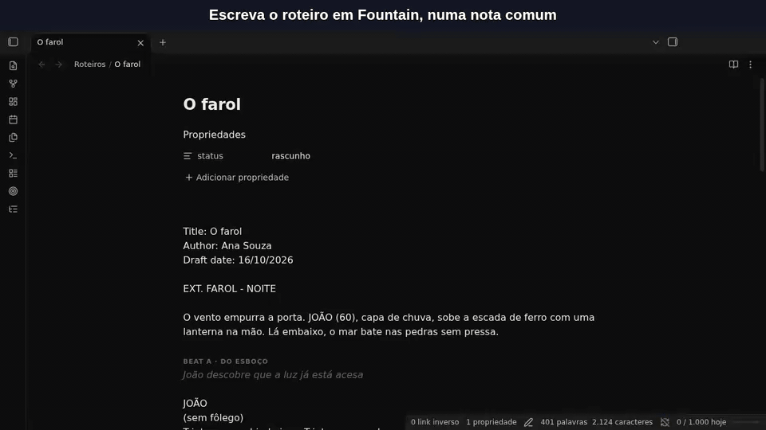

# Roteiros

Esta página cobre como escrever um roteiro numa nota e enviá-lo: como uma nota vira roteiro,
como escrever o roteiro em Fountain puro, exportar em PDF ou em arquivo Fountain, a folha de
rosto, as quebras de página e as configurações. É novidade da 1.1.0.

O Escrita ainda não monta o roteiro no editor. Você escreve Fountain como texto puro, numa nota
como outra qualquer, e o layout acontece na exportação. Planejar e revisar funcionam como num
conto.



O mesmo em vídeo: [screenplay-export.mp4](../../images/screenplay-export.mp4).

Outras páginas: [Publicação](publishing.md), [Escrita](writing.md),
[Recursos e configurações](features-and-settings.md) e [O mundo](the-world.md). A exportação tem
o seu interruptor em Recursos › Publicação, e tudo aqui precisa dela ligada.

- [Como uma nota vira roteiro](#como-uma-nota-vira-roteiro)
- [Escrever o roteiro](#escrever-o-roteiro)
- [Exportar um roteiro](#exportar-um-roteiro)
- [A folha de rosto](#a-folha-de-rosto)
- [Como as páginas quebram](#como-as-páginas-quebram)
- [Configurações](#configurações)
- [Quando algo parece errado](#quando-algo-parece-errado)

## Como uma nota vira roteiro

Um roteiro é uma nota. O que faz dela um roteiro é a **forma**, a mesma propriedade que
distingue um conto de um romance. Há dois jeitos de definir:

- **Uma propriedade na nota.** A propriedade de forma é `form` por padrão, e a palavra do roteiro
  é `screenplay` (`roteiro` numa instalação em português):

  ```
  ---
  form: roteiro
  status: rascunho
  ---
  ```

- **Uma pasta.** Em Configurações › Escrita › Formas, acrescente uma linha em **Forma por pasta**,
  como `Roteiros: roteiro`. Toda nota dessa pasta recebe a forma, a menos que tenha a própria
  propriedade de forma.

O Escrita nunca escreve a forma nas suas notas. As palavras de forma são os **Valores de forma**, nesta
ordem: conto, ensaio, novela, romance, poema, fragmento, roteiro. Se você salvou uma lista com
seis palavras antes da 1.1, ela ganha a palavra do roteiro sozinha.

As linhas de forma valem com ou sem o universo. Na 1.1 elas saíram da seção Universo e foram
para um grupo **Formas**, logo depois de Livros. Veja
[Recursos e configurações](features-and-settings.md).

Com o universo ligado, o nome de uma personagem acima de uma fala conta como aparição em **Aparece
em**. Veja [O mundo](the-world.md#o-que-conta-como-menção).

Só uma nota avulsa é um roteiro. Um livro ou uma coleção que tenha notas de roteiro dentro
continua sendo exportado como prosa (DOCX, Markdown ou EPUB).

## Escrever o roteiro

Escreva em Fountain puro. As regras são as que os outros aplicativos de roteiro usam, então um
roteiro colado de um deles é lido do mesmo jeito. Uma linha em branco separa os elementos. Eis
uma cena curta:

```
EXT. FAROL - NOITE

O vento empurra a porta. JOÃO (60), capa de chuva, sobe a escada de ferro com uma lanterna.

JOÃO
(sem fôlego)
Trinta anos subindo isso. Trinta anos e a luz nunca falhou.

CORTA PARA:

INT. CASA DE CONCEIÇÃO - NOITE
```

Como é cada elemento:

| Elemento | Como escrever |
|---|---|
| Cabeçalho de cena | Uma linha depois de uma linha em branco que começa com um dos **Começos de cabeçalho de cena** (`INT`, `EXT`, `EST`, `INT./EXT`, `INT/EXT`, `I/E`), seguido de ponto ou espaço. Para forçar um, comece a linha com ponto: `.O SÓTÃO`. Um número entre cerquilhas no fim, `INT. COZINHA - DIA #12#`, é o número da cena. |
| Ação | Qualquer outro parágrafo. Uma linha de ação que começa com tab ou quatro espaços mantém o recuo. Para forçar ação, comece a linha com `!`. |
| Nome da personagem | Uma linha em maiúsculas depois de uma linha em branco, com uma linha logo abaixo. Acentos não atrapalham (`JOÃO`). Uma extensão vai entre parênteses: `JOÃO (V.O.)`. Para um nome que não está em maiúsculas, comece com `@`. Um `^` no fim faz da fala um diálogo duplo, lado a lado com a anterior. |
| Indicação entre parênteses | Uma linha entre parênteses dentro de uma fala. |
| Diálogo | As linhas abaixo do nome. Uma fala vai até a próxima linha em branco. |
| Letra de música | Uma linha começando com `~`. |
| Transição | Uma linha em maiúsculas que termina com um dos **Finais de transição** (`TO:` e `PARA:` numa instalação em português), com linhas em branco em volta. Para forçar uma, comece a linha com `>`: `> FADE OUT.` |
| Texto centralizado | `> FIM <` |
| Quebra de página | Uma linha com três ou mais `=`. |
| Seção e sinopse | `# Primeiro ato` e `= João descobre a lanterna apagada`. São para você: nunca saem impressas. |

A ênfase funciona dentro de qualquer elemento: `*itálico*`, `**negrito**`, `***negrito
itálico***` e `_sublinhado_`. Uma barra invertida antes de uma marca a deixa como texto comum.

Onde o Fountain e o Markdown discordam, **o roteiro vence** dentro de uma nota de roteiro. `#` é
uma seção, não um título. `>` começa uma transição ou um texto centralizado, não uma citação. Uma
linha com recuo nunca é código. Uma linha `---` é ação, não uma quebra de cena. Nada se
perde: toda linha é lida como alguma coisa, e uma linha desconhecida é ação.

Mais três coisas que você pode escrever:

- **Boneyard.** O texto entre `/*` e `*/` fica fora do roteiro. Um `/*` sem `*/` depois é texto
  comum.
- **Links.** `[[Nota]]` continua sendo um link do Obsidian e sai impresso como o texto dele.
  `[[Nota|texto]]` sai `texto`.
- **Um bloco de título.** As linhas `Title:`, `Credit:`, `Author:`, `Source:`, `Draft date:` e
  `Contact:` do Fountain no alto da nota preenchem a folha de rosto. Veja
  [A folha de rosto](#a-folha-de-rosto).

### Beats, marcadores e threads

Eles continuam funcionando, porque são comentários `%% … %%`:

```
%% beat: João descobre que alguém mexeu no farol %%
%% XXX: o nome da ilha %%
%% thread: quem mexeu na lanterna? %%
```

O esboço mostra o beat, um marcador continua sendo um marcador (e a exportação avisa dele como
faz num conto), e a thread aparece no painel de threads. **Nenhum deles sai impresso**, nem no
PDF nem no arquivo Fountain. Os seus outros comentários `%% … %%` ficam de fora do PDF. No
arquivo Fountain também ficam de fora, a menos que você marque **Levar as notas**.

## Exportar um roteiro

Abra o roteiro e rode **Exportar…**, ou escolha **Exportar…** no menu do arquivo. Quando a forma
da nota é roteiro, a linha **Formato** oferece duas opções, e só elas:

- **PDF**, no layout que um concurso ou um produtor espera.
- **Fountain**, texto puro que você abre em outro aplicativo de roteiro.

Um roteiro não sai em DOCX, Markdown nem EPUB. Os avisos, a prévia, **Exportar de novo** e
**O arquivo já existe** funcionam como em
[Publicação](publishing.md#exportar-uma-nota-ou-um-livro).

### PDF

Para um PDF, a janela tem uma linha **Página** e uma caixa de seleção:

- **Página**: **US Letter** (a dica diz "EUA") ou **A4** (a dica diz "Brasil, Europa"). Na
  primeira vez, vem da configuração **Tamanho da página**. Depois a janela lembra a escolha de
  cada roteiro.
- **Números de cena nas margens**: números nas duas margens de cada cabeçalho de cena, como num
  roteiro de filmagem. Vem da configuração **Números de cena**, desligada por padrão, que é o
  que um concurso pede. Um cabeçalho com número próprio (`#12#`) imprime esse número. Os outros
  são numerados 1, 2, 3, em ordem.

Embaixo das opções, uma linha diz para onde vai o arquivo e quanto ele tem, por exemplo
"Courier 12, cerca de 14 páginas. Folha de rosto com o título, “Roteiro de”, o autor e o contato
das configurações." O PDF é em Courier 12. O Escrita não embute fonte: todo leitor de PDF tem a
Courier. O número da página fica no alto, à direita, a partir da página 2. A folha de rosto não
tem número.

### Fountain

Num arquivo Fountain não há linha **Página** nem prévia, porque o Fountain não tem páginas. A
linha embaixo das opções diz "Grava …, texto puro para Highland, Fade In, WriterDuet ou Final
Draft. A folha de rosto vira o bloco Title:."

**Levar as notas %% … %% como notas do Fountain**, desligada por padrão e desligada de novo a cada
vez que você abre a janela: os seus comentários `%% … %%` entram no arquivo como notas do
Fountain, `[[assim]]`. Beats, marcadores e threads nunca entram. Uma nota no meio de uma linha
vai para um parágrafo só dela, logo antes do bloco em que estava. O Escrita não importa Fountain,
então essas notas não voltam como comentários se você ler o arquivo de novo.

### A prévia

**Prévia** mostra as páginas como o PDF vai ficar, com as mesmas quebras: uma **Folha de
rosto**, depois **Página 2**, **Página 3** e assim por diante. Seções e sinopses não aparecem.
**Voltar** retorna às opções. Nada é gravado até você apertar **Exportar**.

### O aviso de caracteres que a Courier não imprime

Um PDF só imprime os caracteres que a Courier tem. Letras do português, travessões, aspas curvas
e reticências saem certos. Um emoji, uma estrela, `ő` ou uma letra de outro alfabeto, não. O
Escrita imprime um ponto de interrogação no lugar e avisa antes. A caixa **Antes de enviar** lista
os caracteres (“2 caracteres que a Courier não imprime saem como “?”: ★, ő”), com um link **Ir
para a linha** para cada linha da nota que tem algum. Um caractere na folha de rosto é nomeado,
sem link. O botão passa a dizer **Exportar mesmo assim**. Só o PDF tem esse aviso: um arquivo
Fountain leva qualquer caractere.

### Para onde vai o arquivo

Para a **Pasta das exportações**, como em qualquer exportação. Os nomes são:

- `Título (Letter).pdf` ou `Título (A4).pdf`
- `Título.fountain`

Se o arquivo já existe, você tem as mesmas três escolhas de um manuscrito (**Cancelar**,
**Manter os dois** e **Substituir**). O Escrita diz "Exportado: Título (A4).pdf, 14 páginas."

### Exportar de novo

A janela lembra, para cada roteiro, o formato e a página, e mostra "Última exportação: PDF · A4 ·
14 páginas · 15 out, 21:04" com o nome do arquivo. **Exportar de novo** repete a última
exportação. Um PDF com números de cena é repetido com os números. **Levar as notas** não é
lembrada: ela começa desligada.

## A folha de rosto

O PDF começa com uma folha de rosto, e o arquivo Fountain começa com um bloco `Title:`. Os dois
são montados do mesmo jeito, a partir disto:

| Linha | De onde vem |
|---|---|
| Título | O título da nota. |
| Crédito | A configuração **Linha de crédito** (“Roteiro de”). Só aparece quando há um autor. |
| Autor | A propriedade de autor da nota, ou o **Nome do autor**, em Configurações › Exportação. É a mesma regra da assinatura de um conto. |
| Fonte | A propriedade dada em **Propriedade da fonte** (`source`). A linha fica de fora quando o roteiro não tem. |
| Data da versão | A propriedade dada em **Propriedade da data da versão** (`draftDate`). |
| Contato | **Linhas de contato**, em Configurações › Exportação. |

Então o autor e o contato são os que você já definiu para os manuscritos. Não há outros só para
roteiros.

Uma propriedade pode ser texto ou número. Uma lista é juntada por vírgulas, e um link como
`[[A ilha]]` vira o nome dele.

Um bloco `Title:` do Fountain no alto da nota preenche **só o que ainda está vazio**. Um roteiro
colado de outro aplicativo, com as próprias linhas `Author:` e `Contact:`, ganha uma folha de
rosto, e as suas configurações e propriedades vencem onde tiverem valor. O bloco em si nunca é
impresso como parte do roteiro.

## Como as páginas quebram

O Escrita segue o layout usual da indústria: Courier 12, dez caracteres por polegada e seis
linhas por polegada, margem esquerda de 1,5 polegada e direita de 1 polegada. Uma página tem 55
linhas na Letter e 57 na A4.

- Um **cabeçalho de cena** nunca termina uma página. As linhas que vêm depois vão com ele.
- O **nome da personagem** e uma **indicação entre parênteses** nunca terminam uma página.
- Uma **transição** nunca começa uma página. A linha antes dela vem junto.
- A **ação** pode se dividir entre linhas, com pelo menos duas linhas de cada lado.
- Uma **fala** só se divide entre páginas no fim de uma frase. A primeira página termina com o
  rótulo de "continua" embaixo da fala (`(MAIS)`, ou `(MORE)` em inglês), e a seguinte abre com o
  nome da personagem e o rótulo de "continuação" (`JOÃO (CONT.)`, ou `JOHN (CONT'D)`). Se a fala
  não tem fim de frase onde possa se dividir, ela vai inteira para a página seguinte.
- O **diálogo duplo** fica lado a lado e nunca se divide.
- Uma linha `===` começa uma página nova.
- Seções e sinopses não são impressas.

Duas coisas que o Escrita não faz. Ele não acrescenta `(CONT.)` quando a mesma personagem volta a
falar depois de uma linha de ação. Ele não imprime marcas `CONTINUED:` no pé e no alto das
páginas. Se quiser um `(CONT.)` depois do nome, digite como extensão.

Os recuos seguem a especificação do Fountain: tabs e espaços no começo da linha são ignorados
em todo elemento, menos na ação. Um `CORTA PARA:` com tab é uma transição, um nome com recuo
acima de uma fala é um nome de personagem, e assim por diante. Só uma linha que é ação depois de
todas as regras mantém o recuo. Para manter como ação uma linha com recuo que parece outro
elemento, digite `!` antes do recuo: `!    CORTA PARA:`.

## Configurações

Todas ficam em Configurações › Escrita › Exportação, num grupo chamado **Roteiros**. O grupo
aparece enquanto a Exportação está ligada. Todas aparecem na busca de configurações do Obsidian.

| Configuração | O que faz | Inglês | Português (Brasil) |
|---|---|---|---|
| Começos de cabeçalho de cena | Uma linha que começa com um destes, seguido de ponto ou espaço, é um cabeçalho de cena. Separe com vírgulas. | `INT, EXT, EST, INT./EXT, INT/EXT, I/E` | igual |
| Finais de transição | Uma linha em maiúsculas que termina com um destes é uma transição, como CORTA PARA:. Separe com vírgulas. | `TO:` | `TO:, PARA:` |
| Tamanho da página | A página do PDF: **US Letter** ou **A4**. | US Letter | US Letter |
| Números de cena | Números nas duas margens de cada cabeçalho de cena no PDF. Deixe desligado num roteiro para concurso. | desligado | desligado |
| Rótulo de continua | Impresso embaixo de uma fala que continua na página seguinte. | `(MORE)` | `(MAIS)` |
| Rótulo de continuação | Impresso depois do nome da personagem no alto da página seguinte, onde a fala continua. | `(CONT'D)` | `(CONT.)` |
| Linha de crédito | Na folha de rosto, entre o título e o autor. | `Written by` | `Roteiro de` |
| Propriedade da fonte | Uma propriedade do roteiro com a obra em que ele se baseia, como um conto. | `source` | `source` |
| Propriedade da data da versão | Uma propriedade do roteiro com a data da versão para a folha de rosto. | `draftDate` | `draftDate` |

O autor e o contato da folha de rosto não estão aqui. São as linhas **Propriedade do autor**,
**Nome do autor** e **Linhas de contato** que ficam acima, na mesma seção.

Cada uma é uma configuração, então nada nos seus roteiros está fixo no código. Uma instalação em
português recebe as palavras em português pelo preparo, em **Idioma dos padrões**. Veja
[Recursos e configurações](features-and-settings.md#o-idioma-dos-padrões).

As linhas de forma ficam num grupo próprio, **Formas**, logo depois de Livros:

| Configuração | O que faz |
|---|---|
| Propriedade de forma | A propriedade que distingue um conto de um romance ou de um roteiro. `form`. |
| Valores de forma | As palavras de cada forma, separadas por vírgula, nesta ordem: conto, ensaio, novela, romance, poema, fragmento, roteiro. |
| Forma por pasta | Obras nestas pastas recebem esta forma quando não têm a propriedade. Uma por linha, como Pasta: forma. |

## Quando algo parece errado

| Você vê | Por quê | O que fazer |
|---|---|---|
| **Exportar…** oferece DOCX e não PDF | A forma da nota não é roteiro | Defina a propriedade de forma, ou ponha a pasta em **Forma por pasta** |
| Um livro com roteiros dentro sai como prosa | Só uma nota avulsa é um roteiro | Exporte cada roteiro a partir da própria nota |
| Uma linha de ação com recuo é lida como nome de personagem, cabeçalho ou transição | Os recuos são ignorados fora da ação, como na especificação do Fountain | Digite `!` antes do recuo |
| Um nome de personagem é lido como ação | Tem letras minúsculas, ou não há linha logo abaixo | Escreva o nome em maiúsculas, ou comece a linha com `@` |
| Um cabeçalho é lido como ação | O começo dele não está em **Começos de cabeçalho de cena**, ou não há linha em branco acima | Acrescente o começo, ou inicie a linha com ponto |
| Uma transição é lida como ação | O final dela não está em **Finais de transição**, ou não há linhas em branco em volta | Acrescente o final, ou inicie a linha com `>` |
| O PDF tem um "?" | A Courier não imprime esse caractere | Troque o caractere, ou envie um arquivo Fountain |
| A folha de rosto está sem crédito | A nota não tem autor | Defina a propriedade de autor ou o **Nome do autor** |
| Uma fala foi inteira para a página seguinte | Ela não tem fim de frase onde possa se dividir | Divida você mesmo com um novo nome de personagem, ou termine uma frase antes |
| O grupo **Roteiros** não aparece | A Exportação está desligada | Ligue a Exportação em Recursos |
